# Quantum Digital Dentistry

**Your Complete Smile Destination. All your dental solutions, digitally advanced.**

The website and staff portal for Quantum Digital Dentistry, Hyderabad. Patients find treatments and book visits. Doctors and staff manage appointments, patients, festival offers and website content from one place, on a computer or a phone.

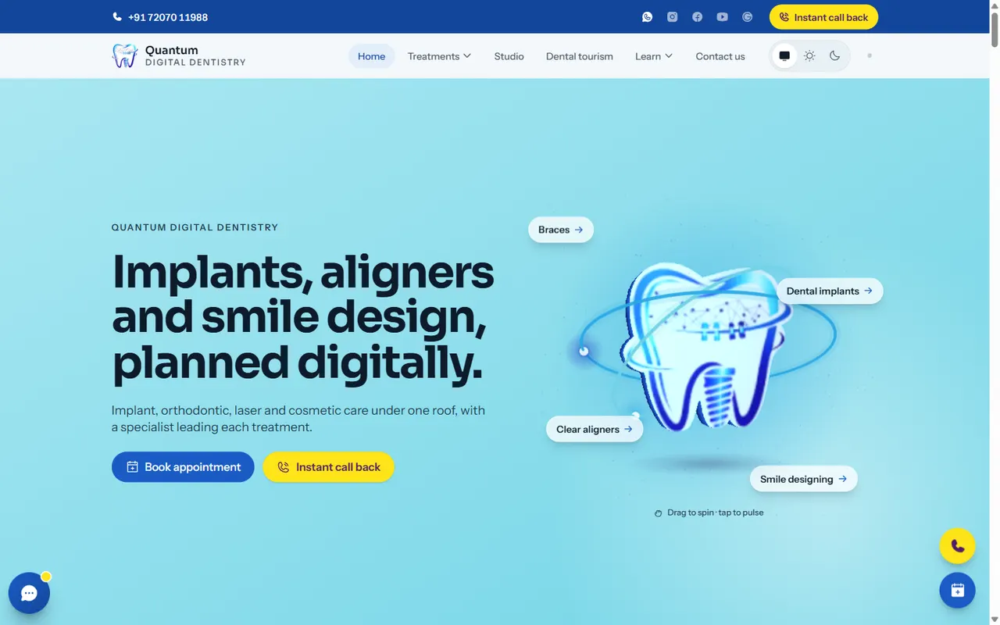

> Developers: setup, architecture and commands are in the **[Developer guide](DEVELOPERS.md)**.

---

## For patients

### Every treatment, explained clearly

All 12 treatments the clinic offers, each with its own page: what it is, who it suits, the steps, recovery and common questions.

Braces · Clear aligners · Dental implants · Veneers and laminates · Tooth-coloured fillings · Smile designing · Root canal treatment · Full mouth rehabilitation · Dentures · Professional teeth cleaning · Teeth whitening · Crowns and bridges

| Treatments                                      | A treatment page                                                  |
| ----------------------------------------------- | ----------------------------------------------------------------- |
| 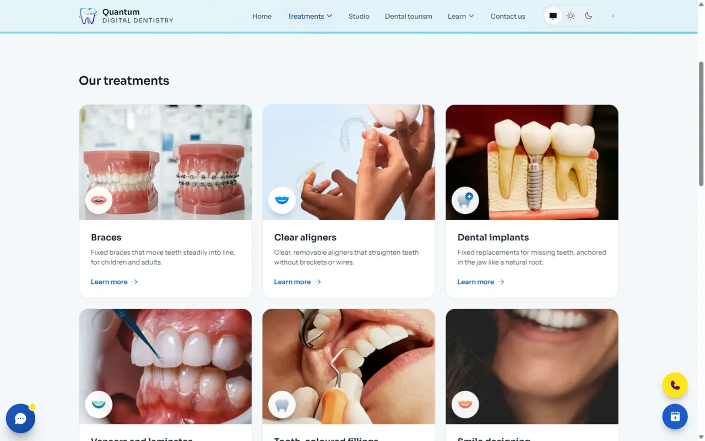 | 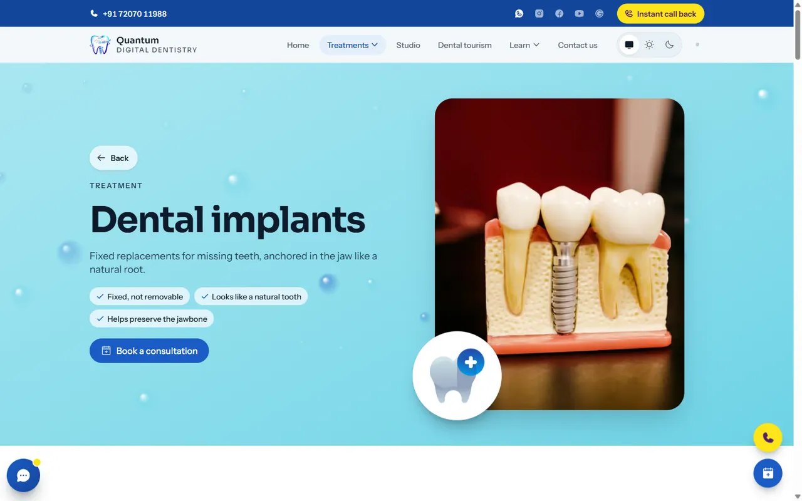 |

### Book in under a minute

- **Request an appointment** in three steps (treatment, preferred day and time, name and mobile number). The front desk calls back to confirm.
- **Instant call back** button on every page.
- **Map, directions and opening hours**, with WhatsApp and call buttons.

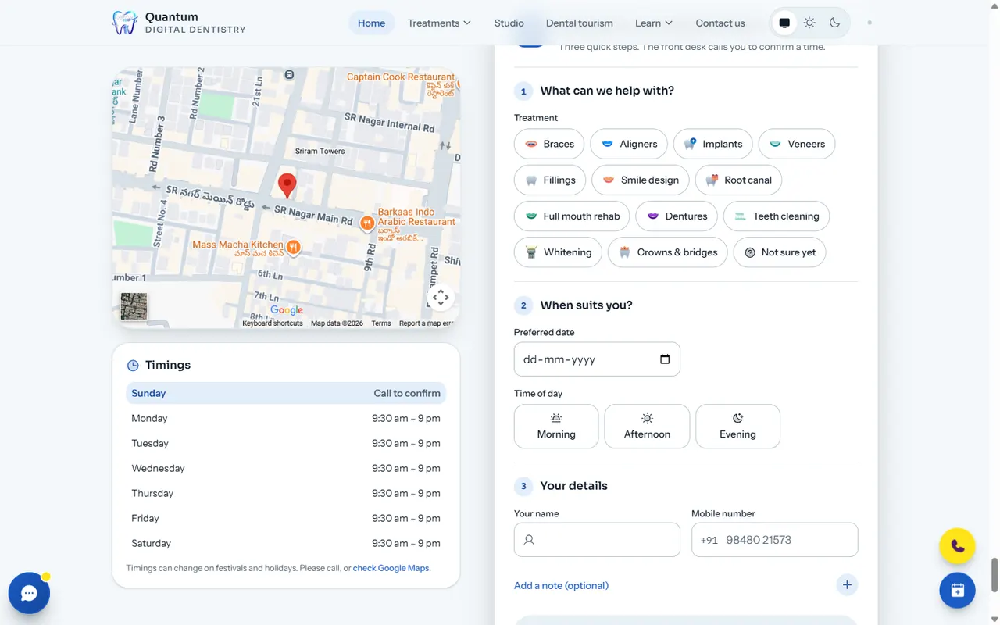

### See the clinic before you come

- **The Studio**: the treatment rooms, the NovoLase Gold laser and the specialists.
- **Gallery** of photos and videos, viewable full screen.
- **Smile results**: before and after cases (shown only with patient consent).
- **Dental tourism** guide for patients travelling from abroad.
- **Dental knowledge**: articles written by the clinic.

| The Studio                              | Gallery                                   |
| --------------------------------------- | ----------------------------------------- |
| 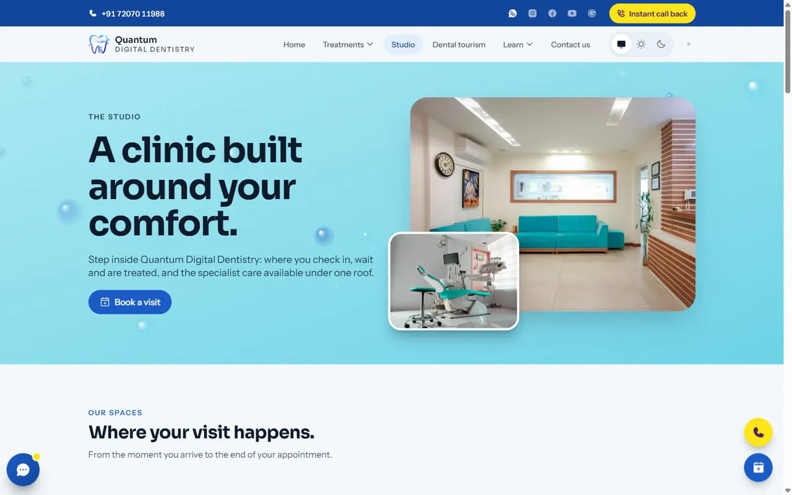 | 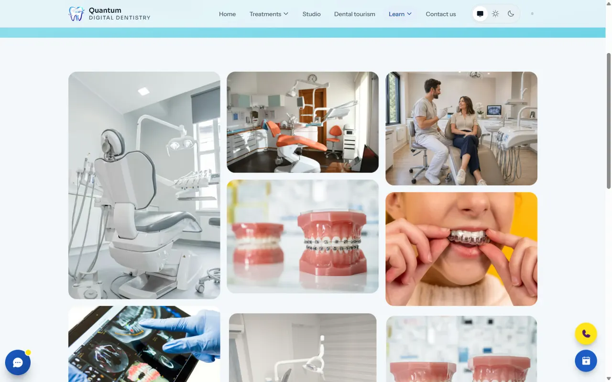 |

### Festival celebrations

When the clinic switches on a festival (Diwali, Ganesh Chaturthi, Sankranti, Eid, Christmas and more), the whole site changes to that festival's colours. It shows the festival's deity or symbol, gentle festive lights and a greeting with the clinic's festival offer.

| Festival banner                                         | Festival offer popup                                        |
| ------------------------------------------------------- | ----------------------------------------------------------- |
| 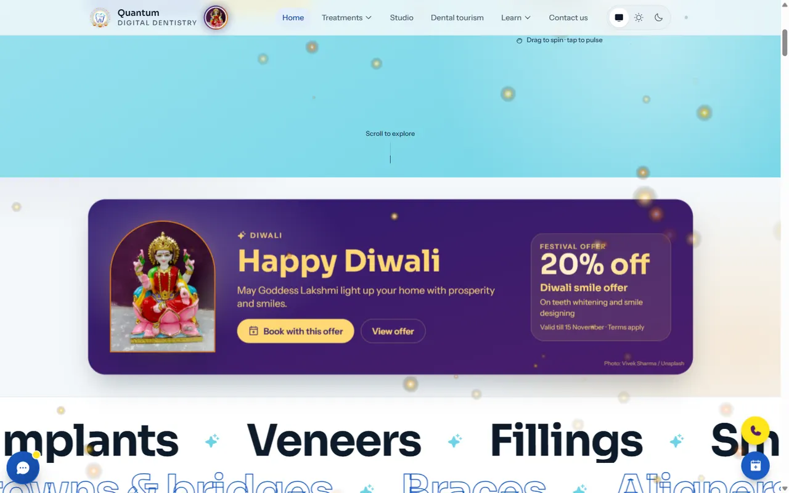 | 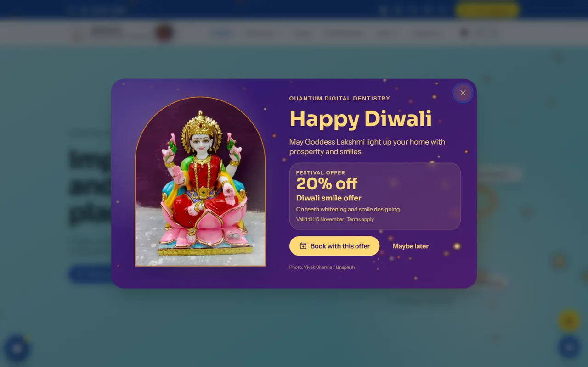 |

### Comfortable on any device

Built for phones first. It works in light and dark mode, and animations calm down for visitors who prefer reduced motion.

| Dark mode                                     | Phone                                       |
| --------------------------------------------- | ------------------------------------------- |
| 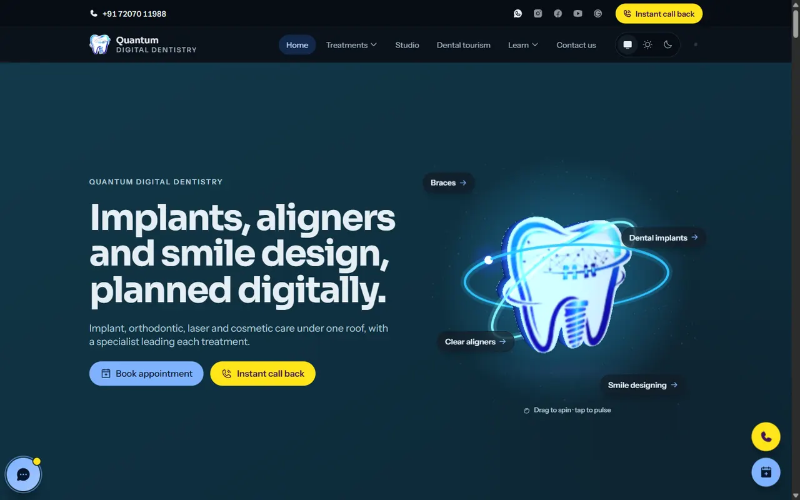 | 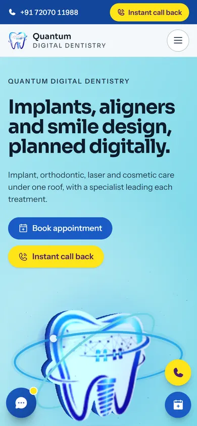 |

---

## For doctors and staff: the staff portal

Sign in at **`/staff/login`**. The link is deliberately not shown to patients, so ask the clinic admin for it. Accounts are invite-only.

### Appointments and calendar

- New website requests appear instantly, with a count of requests waiting.
- **Allocate** a doctor and time to confirm a request. The calendar is shared, so every doctor and staff member sees and can update every appointment live.
- The calendar refuses to double-book a doctor.
- One tap to **call**, **WhatsApp** or **SMS** the patient with a ready-made confirmation or a list of free slots.
- The clinic gets an **email** for every new booking.

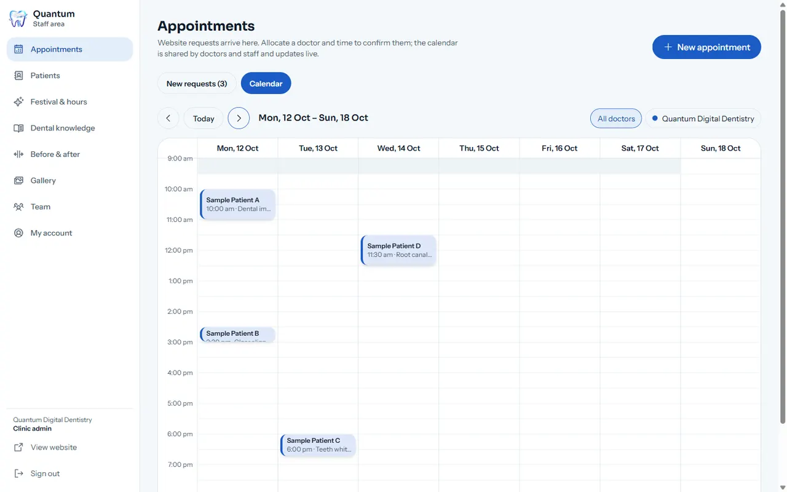

### Patients

Search by name or mobile number, and filter by treatment, date or status. Each patient shows their full visit history.

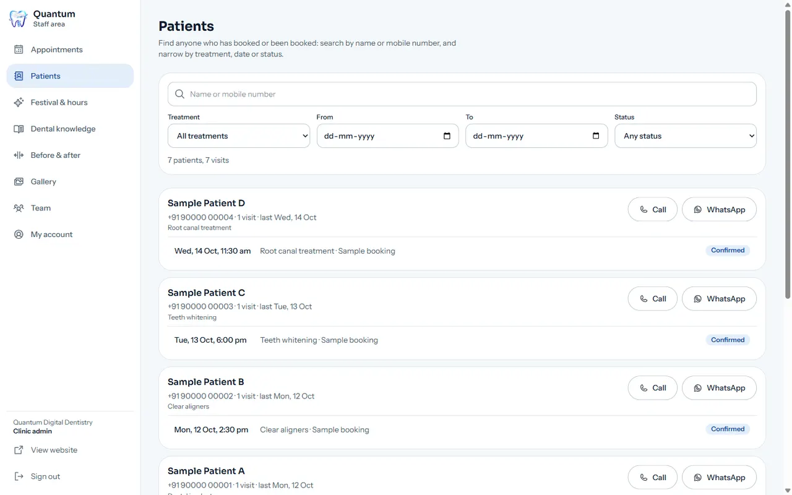

### Festival offers

Pick a festival, add an offer (discount, title, details, last date) and choose whether to show a welcome popup. The site updates for everyone immediately. The theme **stays on until you press "Remove festival theme"**, and an offer hides itself after its last date.

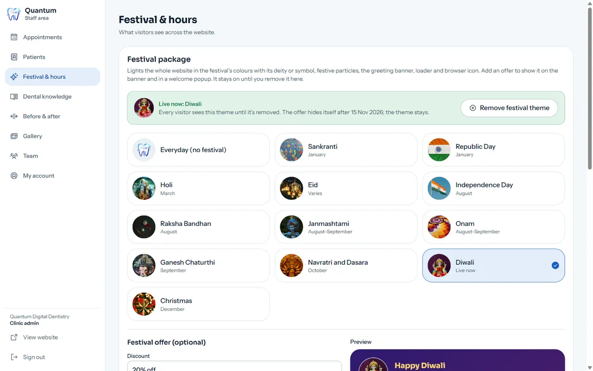

### Website content

- **Gallery**: upload photos (location data is removed automatically) or add **YouTube / Google Drive video links**.
- **Before & after**: publish smile results, only after ticking patient consent.
- **Dental knowledge**: write and publish articles.
- **Opening hours**: update the timings shown on the site.

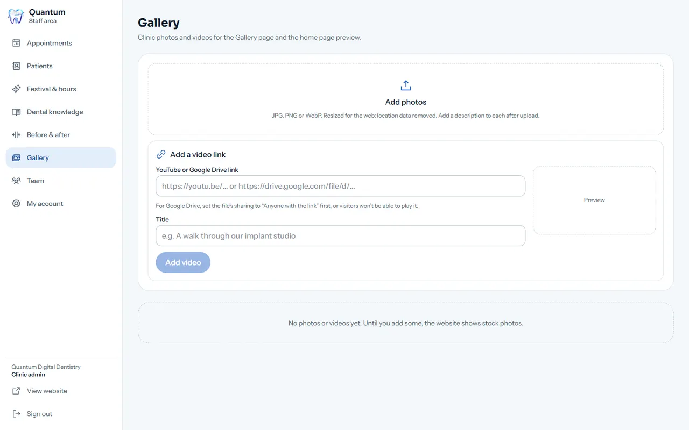

### Team and security

| Who                              | Can                                                                                 |
| -------------------------------- | ----------------------------------------------------------------------------------- |
| **Staff**                        | Manage appointments, patients, festival, hours and website content                  |
| **Doctors**                      | Everything staff can, plus add or remove doctors and staff                          |
| **Super admin** (clinic account) | Everything, including making someone a super admin. Also has a calendar as a doctor |

Strong passwords are required, nobody can change their own role, and signing out returns to the website. Patient data is protected by database-level security rules, not just by the screens.

---

## Contact

**Quantum Digital Dentistry**, 3rd Floor, Flat No. 33/A, Sri Sai Govardhan Kunj, 7-1-397/101, 301/A, opposite Domino's Pizza, near Community Hall, Hyderabad, Telangana 500038
Phone / WhatsApp: **+91 72070 11988**
Monday to Saturday, 9:30 am to 9 pm

Specialists: **Dr D Reddy Pradeep** (Orthodontics & Dentofacial Orthopaedics) · **Dr B Mohana Bindu** (Prosthodontics & Implantology, Fellowship in Laser Dentistry)

Stock photos from [Unsplash](https://unsplash.com) (credited on the site) until the clinic's own photos are added.

Website developed by [Jayanth](https://www.linkedin.com/in/gandhodijayanth/).
