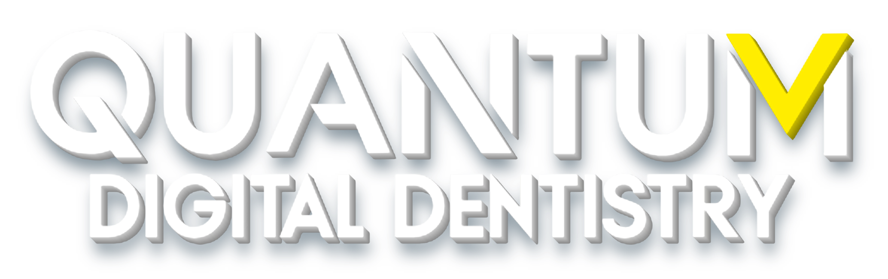

# Quantum Digital Dentistry – logo assets

Extracted pixel-for-pixel from the original (background removed, letterforms unchanged), upscaled 4×, transparent PNG.

- quantum-logo-transparent-4x.png – flat, no effects (1908×492)
- quantum-logo-shadow-4x.png – soft drop shadow
- quantum-logo-3d-4x.png – 3D extrusion depth + shadow
- quantum-logo-1x.png – original-size cutout

## Responsive use (HTML/CSS)

```html

```

Flutter: `Image.asset('assets/quantum-logo-3d-4x.png', width: double.infinity, fit: BoxFit.contain)`
React Native: `<Image source={require('./quantum-logo-3d-4x.png')} style={{width:'100%', aspectRatio:1908/492}} resizeMode="contain" />`

Logo is white/yellow – place on a colored or dark background.
